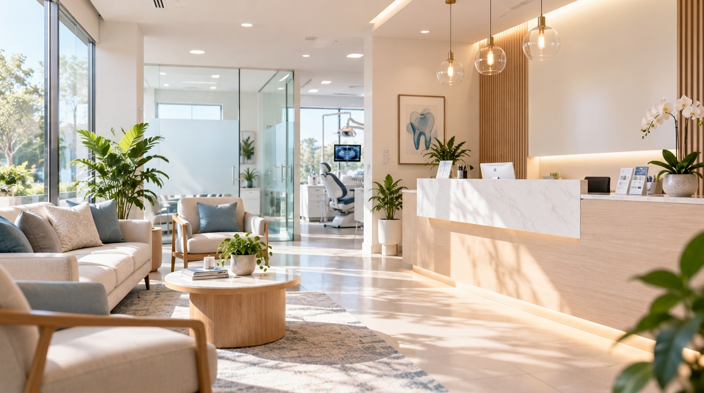

# Lumina Dental — Next.js 16 Template

A production-ready Next.js 16 template for dental / medical / clinic websites.
Built with **TypeScript strict**, **Tailwind CSS v4**, **shadcn/ui**, and a
**central configuration system** so you can rebrand the whole site from one file
instead of editing dozens of components.



**Status:** verified with `npm run typecheck` (0 errors), `npm run lint` (0 errors, 0 warnings), and `npm run build` (13 routes).

---

## ⚡ Quickstart (5 minutes)

```bash
npm install
npm run dev
```

Open http://localhost:3000.

**To rebrand, edit `src/config/site.tsx`.** Change the clinic name, colors,
contact info, hero copy, services, doctors, features, forms, and map coordinates — the
home page, navigation, footer, appointment, contact, and legal pages all read from it.

```ts
clinic:  { name: "Your Clinic", tagline: "Your Tagline" },
contact: { phone: "(555) 123-4567", email: "hello@yourclinic.com", mapCenter: { lat: 40.758, lng: -73.9855 } },
hero:    { headline: "Advanced Dentistry.", headlineAccent: "Designed Around You." },
services: [ /* ... */ ],
doctors:  [ /* ... */ ],
```

> **Note on config coverage.** Every page — including the list/detail pages
> (`/services`, `/services/[slug]`, `/doctors`, `/doctors/[slug]`,
> `/testimonials`) — renders from `src/config/site.tsx`, so editing that one
> file updates the whole site. See [`CUSTOMIZATION.md`](./CUSTOMIZATION.md) for
> the full guide.

Then read [`CUSTOMIZATION.md`](./CUSTOMIZATION.md) for the full guide.

---

## ✨ Features

- **Central config** — rebrand everything from `src/config/site.tsx`
- **13 routes included**:
  - Home (`/`)
  - About (`/about`)
  - Services list (`/services`) & dynamic detail (`/services/[slug]`)
  - Doctors list (`/doctors`) & dynamic detail (`/doctors/[slug]`)
  - Patient Testimonials (`/testimonials`)
  - Appointment Booking (`/appointment`)
  - Contact with interactive map & directions (`/contact`)
  - Privacy Policy (`/privacy-policy`) & Terms of Service (`/terms-of-service`)
  - Custom 404 (`/_not-found`), loading, and error states
  - Form API endpoints (`/api/booking`, `/api/contact`)
- **Animated & polished** — Framer Motion, GSAP + ScrollTrigger, Lenis smooth scroll
- **Zero-API-key Interactive Map** — dynamic OpenStreetMap integration with one-click Google Maps directions and optional custom embed override
- **Working forms** — contact & booking POST to API routes; optional email via Resend (see [`FORM-INTEGRATION.md`](./FORM-INTEGRATION.md))
- **Error & loading states** — `error.tsx`, `not-found.tsx`, `loading.tsx`
- **SEO** — metadata, OpenGraph/Twitter, `sitemap.xml`, `robots.txt`
- **Accessible & responsive** — WCAG AA compliant colors, mobile-first, keyboard-friendly nav, `prefers-reduced-motion` guards
- **TypeScript strict** + ESLint configured

---

## 📦 Scripts

| Script | Description |
|--------|-------------|
| `npm run dev` | Start the development server |
| `npm run build` | Production build (Turbopack) |
| `npm run start` | Run the production build |
| `npm run lint` | Run ESLint |
| `npm run typecheck` | Run TypeScript strict check |
| `npm run package` | Build clean distribution zip in `release/` |

Requires **Node ≥ 20.9** (see `.nvmrc`).

---

## 🔧 Configuration

| File | Purpose |
|------|---------|
| `src/config/site.tsx` | Central config — all themeable values & icons |
| `src/config/images.ts` | All image paths (single source of truth) |
| `src/components/layout/Navbar.tsx` | Responsive navbar with theme-aware logo |
| `src/components/layout/Footer.tsx` | Footer data & links from config |
| `src/components/home/*` | Home sections use config |
| `src/components/contact/ClinicMap.tsx` | Dynamic map with floating directions card |
| `src/app/globals.css` | Brand color tokens / base styles |
| `DESIGN.md` | Design system, color tokens & typography rules |

### Layout variants

Selectable via URL query parameters (defaults shown, switchers hidden in
production UI by default):

| Page | Parameter | Values |
|------|-----------|--------|
| Home | `?hero=` | `cinematic` · `booking` · `specialist` · `minimal` · `immersive` |
| About | `?view=` | `story` · `clinical` · `timeline` |
| Services | `?view=` | `grid` · `list` · `bento` |

```
/?hero=booking
/about?view=timeline
/services?view=bento
```

Preview controls (in-page variant switchers, sample-content notices) are
gated behind `siteConfig.ui.showTemplateSwitchers` and
`siteConfig.ui.showSampleContentNotices` — see
[CUSTOMIZATION.md](./CUSTOMIZATION.md).

---

## 🖼️ Images & Licensing

Every photo path is centralised in **`src/config/images.ts`** and points at
`public/dental/images/`. To rebrand, just drop your own photos into that folder
using the same filenames — see
[`public/dental/images/README.md`](./public/dental/images/README.md) for the
full list and recommended sizes.

The shipped files are **generated placeholders** (gradient cards, no real
photos), so you must supply your own imagery before going live. See
[`public/dental/IMAGE-CREDITS.md`](./public/dental/IMAGE-CREDITS.md) for
licensing notes.

---

## 🚀 Deployment

### Vercel (recommended)

1. Push the project to a Git repository.
2. Import it at https://vercel.com/new.
3. (Optional) Add env vars from `.env.example` for form emails.
4. Deploy.

Or with the CLI:

```bash
npm i -g vercel
vercel
```

### Any Node.js host

```bash
npm run build
npm run start
```

**Before going live:** update the domain in `src/config/site.tsx`
(`seo.metadataBase`), `public/sitemap.xml` and `public/robots.txt`, and set
`NEXT_PUBLIC_SITE_URL` if you prefer env-based config.

---

## 📧 Forms

Contact and booking forms are functional out of the box (server-log fallback).
Enable real email delivery with the `RESEND_API_KEY`, `LEAD_TO_EMAIL` and
`LEAD_FROM_EMAIL` env vars. Full guide: [`FORM-INTEGRATION.md`](./FORM-INTEGRATION.md).

---

## 📄 License

This template is sold under **two tiers**:

- [`LICENSE`](./LICENSE) — personal / evaluation use
- [`LICENSE-COMMERCIAL.md`](./LICENSE-COMMERCIAL.md) — commercial use, client
  projects, rebranding

Buyers of the commercial tier may build unlimited sites and rebrand freely, but
may **not** resell or redistribute the template itself.

---

## 📁 Project Structure

```
src/
├── app/                 # 13 routes (home, about, services, doctors, legal, api)
│   ├── api/             # contact + booking route handlers
│   ├── privacy-policy/  # privacy policy page
│   ├── terms-of-service/# terms of service page
│   ├── error.tsx        # error boundary
│   ├── not-found.tsx    # 404 page
│   └── loading.tsx      # route loading UI
├── components/
│   ├── home/            # home page sections
│   ├── layout/          # Navbar, Footer, PageHero
│   ├── contact/         # ContactForm, ClinicMap
│   └── ui/              # shadcn/ui primitives
├── config/
│   ├── site.tsx         # ★ central configuration & icons
│   └── images.ts        # ★ all image paths
└── lib/                 # utils, send-lead, rate-limit helpers
```

---

## 💬 Support & Docs

- Design system & typography: [`DESIGN.md`](./DESIGN.md)
- Setup & customization: [`CUSTOMIZATION.md`](./CUSTOMIZATION.md)
- Form / email setup: [`FORM-INTEGRATION.md`](./FORM-INTEGRATION.md)
- Packaging for sale: `npm run package` (see [`RELEASE-CHECKLIST.md`](./RELEASE-CHECKLIST.md))
- Changelog: [`CHANGELOG.md`](./CHANGELOG.md)

For purchase support, contact **tanujp09@gmail.com**.

---

**Lumina Dental — Advanced Dentistry Designed Around Your Smile**
